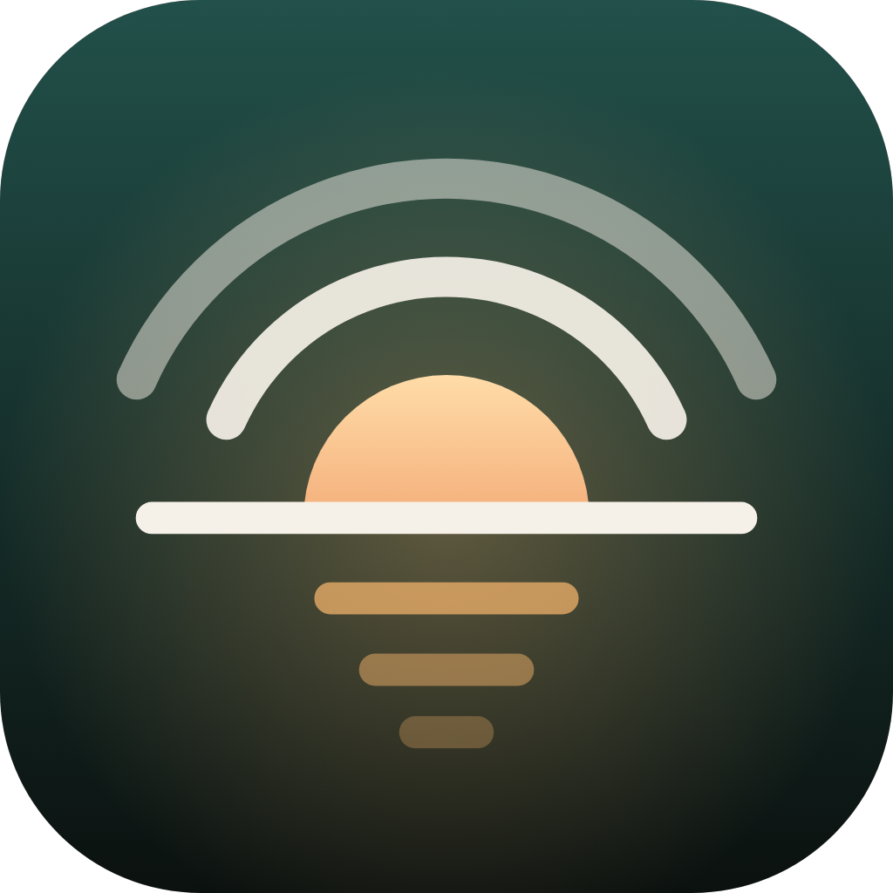

# Farly



One tap scans the Wi‑Fi for televisions and air conditioners, then opens a remote.

Farly is free and open source. Control stays on your local network — no account, no cloud remote.

## Run

```bash
flutter pub get
flutter run
```

### Mac menu bar

```bash
flutter run -d macos
```

On macOS, Farly runs as a menu-bar companion. It talks to TVs on your Wi‑Fi directly — the phone app does not need to be open.

- Status item uses the Farly mark (monotone by default; switch to color from the pad header).
- The floating pad is resizable; drag an edge or corner.
- Same horizon pad, chrome keys, and TV keyboard as on the phone (`⌘T` when the TV accepts text).

### Sync phone → Mac

1. On the phone: open the saved-devices drawer → **Share with Mac** (keep Farly open).
2. Note the **6-digit code** and the **address** under it (`192.168.x.x:port`).
3. On the Mac companion: **Import from phone** → enter both.

Menu-bar apps often miss Bonjour / Local Network discovery, so the address field is the reliable path. Allow **Local Network** for Farly in System Settings if imports time out. Android TV may still ask the Mac to pair once (certs are often per client).

The browser build can show the pad, but it cannot scan a network. Discovery and control run on iOS, Android, and Mac.

## Icon

The logo is drawn by `FarlyMarkPainter` in `lib/widgets/farly_mark.dart`. After changing it, regenerate platform icons (iOS, Android, web, macOS app + menu bar):

```bash
flutter test tool/render_icons_test.dart
```

## What this build controls

- **Roku** over its local HTTP remote (keys, Netflix, YouTube)
- **Samsung** over the TV's remote WebSocket, including the allow prompt and saved token
- **LG webOS** over the registration socket, volume commands, and the pointer buttons after the TV accepts Farly
- **Android TV / Google TV** over the local pairing + remote protocol (certs stored on device)

The scan also recognizes Apple TV, Chromecast, Sony Bravia, and Broadlink infrared hubs. Those open with an honest note instead of a fake connection. Air-conditioner commands are not sent yet.

## Support the developer

Tips keep Farly free. GitHub Sponsors payouts are not available in every country yet (join the [waitlist](https://github.com/sponsors) if your region is unsupported). Prefer Ko-fi or Buy Me a Coffee until Sponsors is live; plug your handle into [`.github/FUNDING.yml`](.github/FUNDING.yml) so the repo Sponsor button can point there.

## Names and domains

`farly.com`, `farly.io`, `farly.app`, `farly.dev`, and `farly.co` are already registered. `getfarly.com` was free when this project was created. The iOS / Mac bundle id is `app.getfarly.farly`.

A Paris app-marketing company already uses the Farly name. Check that trademark before a store submission.

## Network notes

iOS and macOS show a local-network prompt. Roku and many TVs answer SSDP, which also needs Apple's multicast entitlement before that search works on a device. mDNS (Chromecast, Android TV, Apple TV) uses the system discovery API and does not need that entitlement. If a TV does not appear, add it by address.

## Website and license

The site (privacy policy, terms of use, support) lives in `docs/` and is served by GitHub Pages.

Farly is released under the [MIT License](LICENSE). The Farly name and logo are not covered by it.
